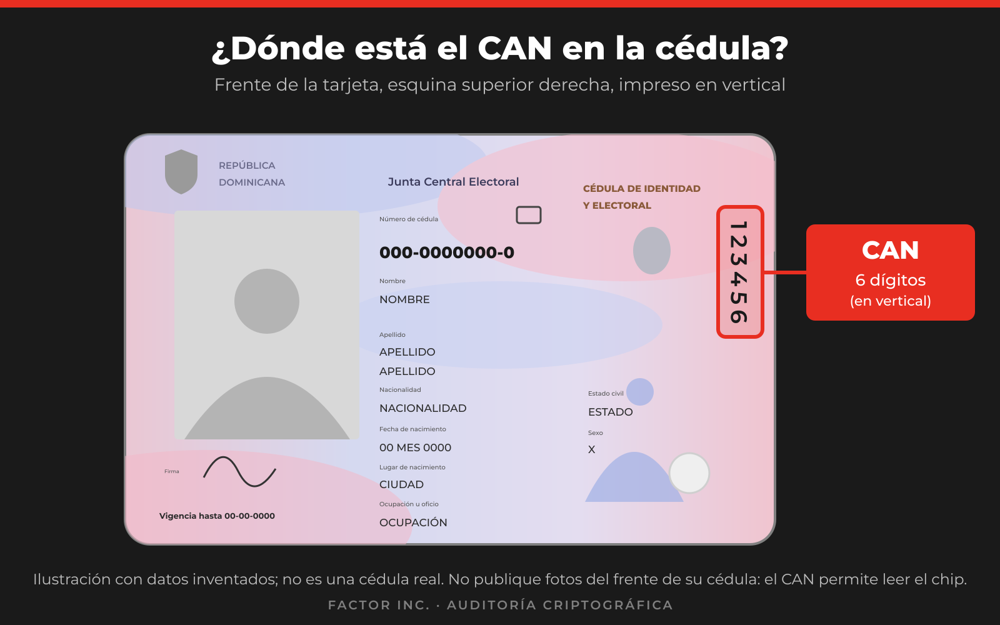

<!-- factor-brand:start -->

<a href="https://projectfactor.io"><picture><source media="(prefers-color-scheme: dark)" srcset="docs/brand/factor-landscape-reverse.svg"></picture></a>

<!-- factor-brand:end -->

# Preguntas frecuentes para ciudadanos

Respuestas breves a lo que la mayoría de la gente querrá saber. Los detalles técnicos están en [`FINDINGS.md`](FINDINGS.md).

## ¿Debo hacer algo con mi cédula hoy?

No hay ninguna acción urgente que usted deba tomar. Siga las indicaciones oficiales de la JCE sobre cualquier tema relacionado a la Cedula Dominicana.

## ¿Es seguro mi cédula?

Esta pregunta no se puede responder con un sí o un no. Esto es lo que sabemos:

- En nuestras pruebas **no encontramos una forma de leer su PIN, ni de alterar los datos guardados en su tarjeta**.
- Encontramos un problema en **cómo se firma uno de los archivos del chip** y en **cómo otros sistemas pueden verificar esa firma**.
- Eso **no significa** que su identidad haya sido robada ni que su tarjeta haya sido alterada.
- Nuestro trabajo no cubre todo. Por eso recomendamos una auditoría completa, respaldada por la JCE.

## ¿Pueden clonar mi cédula?

- Copiar los datos legibles del chip es posible para quien tenga la tarjeta en sus posesion, inclyendo su imagen exacta de firma fisica y cara, porque el **CAN está impreso en el frente**. 
- Lo importante es si un sistema aceptaría esa copia como auténtica. Eso depende de cómo verifique la tarjeta ese sistema. No demostramos ninguna clonación aceptada por un sistema real.

## ¿Cómo me protejo mientras tanto?

- **No publique fotos ni copias del frente de su cédula** en redes sociales ni las envíe sin necesidad. El número CAN que aparece ahí (esquina superior derecha, impreso en vertical) permite leer el chip.
- **Nunca comparta su PIN.** Desconfíe de quien se lo pida por llamada, mensaje o enlace. Las noticias como esta suelen ser aprovechadas por estafadores. Verifique siempre por los canales oficiales.
- Entregue su cédula física solo cuando sea necesario y a quien deba recibirla.

## ¿Debo cambiar mi PIN?

No hay indicios de que su PIN esté comprometido. Cambiarlo es opcional y **no resuelve** el problema encontrado.

## ¿Tengo que reemitir mi cédula por esto?

**No, por ahora.** Recomendamos que la JCE encargue una auditoría completa y decida sobre una posible reemisión según sus resultados. No acuda a reemitir su cédula por este motivo. El plazo oficial de renovación sigue vigente. Consúltelo en los canales de la JCE.

## ¿Mi cédula tiene este problema?

- Todas las tarjetas de producción que examinamos, emitidas desde principios de 2026 hasta septiembre de 2026, lo tenían. - - No podemos afirmar nada sobre las demás.
- Aqui se encuentran las herramientas y las intrucciones que le permiten a cualquier ciudadano confirmar ellos mismos de forma independiente si su cedula tiene este problema.

## ¿Esto afecta mi uso diario de la cédula?

No examinamos bancos, trámites ni otros sistemas que usan la cédula. No tenemos indicios de que este hallazgo afecte la verificación visual ni el uso normal. Si algún sistema le rechaza su cédula, hágaselo saber a la JCE.

## ¿Quién hizo esta investigación y por qué se publica?

La realizó FACTOR Inc., brazo comercial del Proyecto FACTOR que presta servicios de auditoría criptográfica. Ver [Sobre el autor y declaración de intereses](README.md#sobre-el-autor) y la [cronología de divulgación](DISCLOSURE_TIMELINE.md). Los hallazgos se publican para que se corrijan, no para generar alarma.

<!-- factor-footer:start -->
---

© 2026 FACTOR Inc. · Auditoría criptográfica · <a href="https://projectfactor.io">projectfactor.io</a>

<!-- factor-footer:end -->
