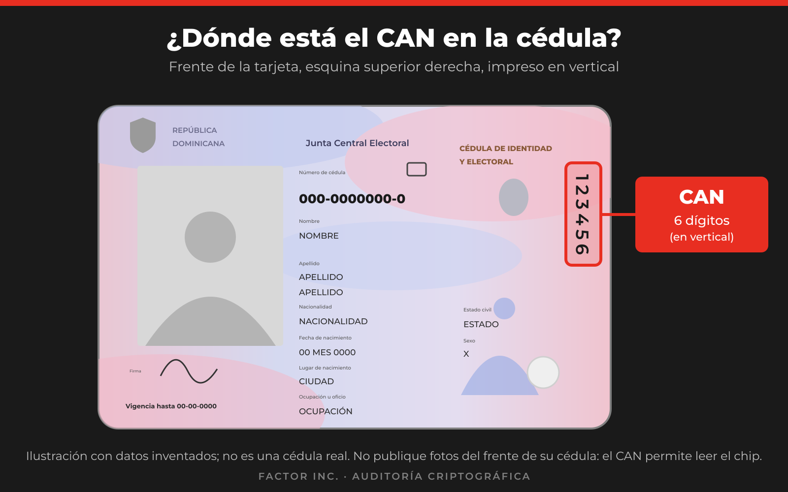

<!-- factor-brand:start -->

<a href="https://projectfactor.io"><picture><source media="(prefers-color-scheme: dark)" srcset="docs/brand/factor-landscape-reverse.svg"></picture></a>

<!-- factor-brand:end -->

# Frequently Asked Questions for Citizens

Brief answers to what most people will want to know. The technical details are in [`FINDINGS_EN.md`](FINDINGS_EN.md).

## Do I need to do anything with my cédula today?

There is no urgent action you need to take. Follow the official JCE guidance on any matter related to the Dominican Cédula.

## Is my cédula secure?

This question cannot be answered with a yes or a no. Here is what we know:

- In our tests we **found no way to read your PIN, or to alter the data stored on your card**.
- We found a problem in **how one of the chip's files is signed** and in **how other systems can verify that signature**.
- That **does not mean** your identity has been stolen or your card has been altered.
- Our work does not cover everything. That is why we recommend a complete audit, backed by the JCE.

## Can they clone my cédula?

- Copying the readable data on the chip is possible for anyone who has the card in their possession, including the exact image of your physical signature and face, because the **CAN is printed on the front**.
- What matters is whether a system would accept that copy as authentic. That depends on how the system verifies the card. We did not demonstrate any clone being accepted by a real system.

## How do I protect myself in the meantime?

- **Do not post photos or copies of the front of your cédula** on social media, and do not send them unnecessarily. The CAN number that appears there (upper right corner, printed vertically) allows the chip to be read.
- **Never share your PIN.** Be wary of anyone who asks for it by phone call, message, or link. News like this is often exploited by scammers. Always verify through official channels.
- Hand over your physical cédula only when necessary and to whoever is entitled to receive it.

## Should I change my PIN?

There is no indication that your PIN is compromised. Changing it is optional and **does not resolve** the problem found.

## Do I have to have my cédula reissued because of this?

**No, not for now.** We recommend that the JCE commission a complete audit and decide on a possible reissuance based on its results. Do not go to have your cédula reissued for this reason. The official renewal deadline remains in effect. Check it with the JCE's channels.

## Does my cédula have this problem?

- All the production cards we examined, issued from early 2026 through September 2026, had it. We cannot say anything about the others.
- The tools and instructions that allow any citizen to independently confirm for themselves whether their cédula has this problem are here.

## Does this affect my everyday use of the cédula?

We did not examine banks, administrative procedures, or other systems that use the cédula. We have no indication that this finding affects visual verification or normal use. If any system rejects your cédula, let the JCE know.

## Who did this research and why is it being published?

It was carried out by FACTOR Inc., the commercial arm of Project FACTOR, which provides cryptographic audit services. See [About the author and declaration of interests](README_EN.md#about-the-author) and the [disclosure timeline](DISCLOSURE_TIMELINE_EN.md). The findings are published so that they get fixed, not to cause alarm.

<!-- factor-footer:start -->
---

© 2026 FACTOR Inc. · Cryptographic audit · <a href="https://projectfactor.io">projectfactor.io</a>

<!-- factor-footer:end -->
