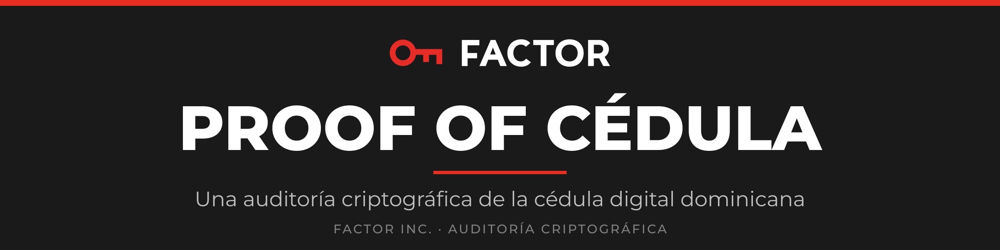
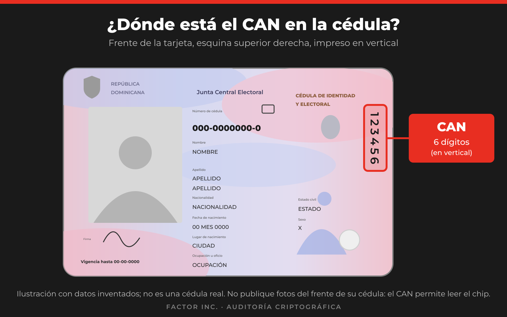
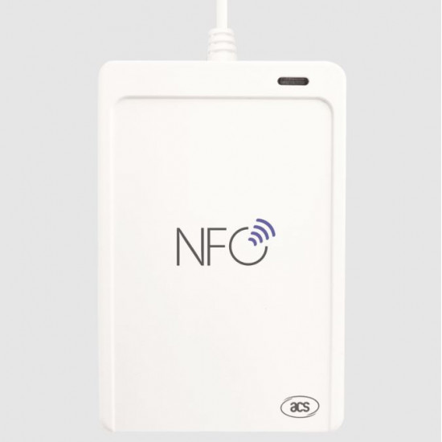
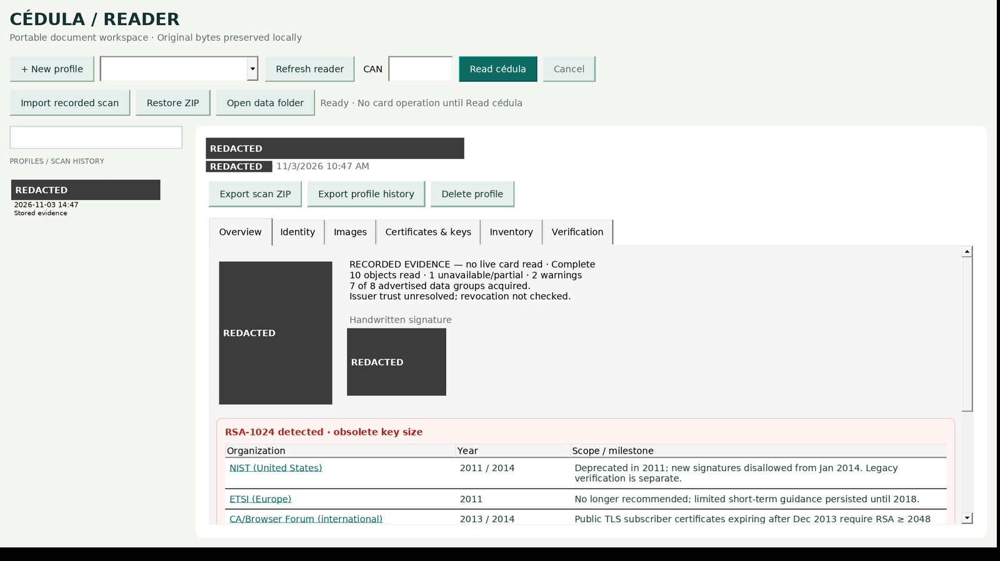
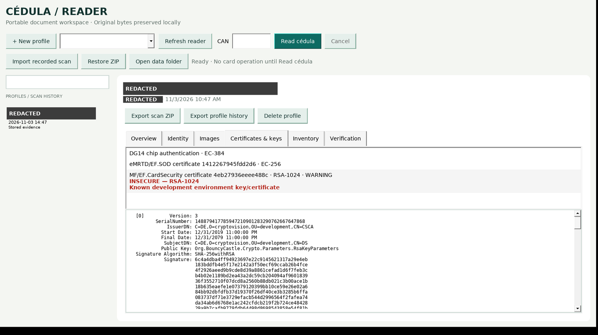

<h1 align="center">
  
</h1>

<p align="center"><b>Hallazgos, evidencia y lectores de código abierto.</b></p>

<p align="center">Una investigación de <b>FACTOR Inc.</b>, brazo comercial del Proyecto FACTOR · <a href="https://projectfactor.io">projectfactor.io</a></p>

<p align="center">
  <a href="report/informe_cedula.pdf"><b>📄 DESCARGAR EL INFORME DE SEGURIDAD (PDF, 3 páginas)</b></a><br>
  <i>Clave de prueba en producción. Raíz de confianza inexistente.</i><br>
  Hallazgos, modelo de amenaza y acciones urgentes, en un formato legible sin conexión.
</p>

Investigación independiente de seguridad sobre el chip de la *cédula de identidad y electoral* de la República Dominicana (sin contacto, basada en ICAO eMRTD). Divulgada a la Junta Central Electoral (JCE) antes de su publicación.

> [!NOTE]
> **La Junta Central Electoral (JCE) ya fue informada de los hallazgos más graves de esta auditoría** antes de su publicación. Véase la [cronología de divulgación](DISCLOSURE_TIMELINE.md).

> [!IMPORTANT]
> ## Nuestra recomendación principal: una auditoría completa, respaldada por la JCE
>
> Este trabajo utilizó **únicamente información pública**. No tuvimos acceso a los registros de la JCE, a las ceremonias de claves, al hardware de firma ni a la documentación del proveedor, por lo que **no puede descartar otras fallas**.
>
> Recomendamos **enfáticamente** que la JCE:
> - **Encargue una auditoría criptográfica independiente y completa**, dirigida por criptógrafos calificados y respaldada por la autoridad de la JCE.
> - **Decida sobre la reemisión de tarjetas solo después de que la auditoría presente sus resultados.**
>
> Detalles: [`FINDINGS.md`](FINDINGS.md#full-audit)

## Contenido

- [Resumen de hallazgos](#resumen-de-hallazgos)
- [Preguntas frecuentes para ciudadanos](FAQ.md)
- [Alcance y ética](#alcance-y-ética)
- [Leer una cédula](#leer-una-cédula)
- [Estructura del repositorio](#estructura-del-repositorio)
- [Reproducir los resultados](#reproducir-los-resultados)
- [Sobre el autor](#sobre-el-autor)
- [Licencia](#licencia)

## Resumen de hallazgos

**Clave de colores**

- 🔴 Defecto confirmado
- 🟠 Brecha de confianza o incertidumbre
- 🟡 Depende del verificador
- 🟢 *Una prueba específica y nombrada pasó en las tarjetas indicadas.* (El verde nunca significa «seguro», «certificado» ni «confiable», y no dice nada sobre tarjetas o ataques no probados.)

La integridad de la firma, la confianza en el emisor, la solidez del algoritmo y la procedencia de desarrollo/producción se reportan por separado y no se mezclan.

| # | Estado | Hallazgo |
|---|---|---|
| 1 | 🔴 Defecto | `EF.CardSecurity` está firmado por un **Document Signer RSA-1024 de un entorno de *desarrollo* del proveedor** (`cryptovision/development`). Algoritmo obsoleto más procedencia de desarrollo. **Una brecha de aseguramiento:** pasó la emisión sin ser detectado (véase Hallazgo 1, Brecha de aseguramiento). Observado en todas las tarjetas de producción examinadas. |
| 2 | 🟠 Brecha de confianza | El URI del ancla CSCA de la JCE (`https://ca.jce.gob.do/csca`) no se resuelve, por lo que un verificador no puede anclar de forma independiente la cadena del firmante de `EF.SOD`. La firma en sí es válida. |
| 3 | 🟢 Pruebas nombradas aprobadas (tarjetas probadas) | La firma de `EF.SOD` es válida y 7 de 7 grupos de datos legibles coinciden con sus hashes firmados. Chip Authentication, las pruebas de manipulación de MAC y degradación de Secure Messaging, las escrituras por CAN/PACE y los contadores de reintentos de PIN se comportaron correctamente. Esto no es una afirmación de que la tarjeta o el emisor sean seguros o confiables. |

Cada hallazgo se desglosa en [`FINDINGS.md`](FINDINGS.md) en un resumen en lenguaje sencillo, la posición regulatoria, el contexto criptoanalítico y los ataques que puede habilitar, incluidos los que requieren otros componentes.

**Escala y reemisión.** Se han entregado ya unos 4.0 millones de cédulas nuevas, de 8.7 millones habilitadas ([Diario Libre](https://www.diariolibre.com/politica/jce/2026/10/13/jce-supera-los-cuatro-millones-de-cedulas-entregadas/3688288)). No recomendamos una reemisión generalizada antes de esa auditoría. Mientras tanto, corregir la personalización de las tarjetas aún no emitidas y luego establecer si las ya emitidas pueden actualizarse. Reemitir solo lo que no pueda corregirse. Razonamiento y condiciones: [`FINDINGS.md`](FINDINGS.md#f1-reissue).

### Riesgo de clonación y falsificación

La protección contra escritura de la tarjeta genuina no es la barrera relevante. Un atacante no necesita escribir en una tarjeta real. Puede leer una, luego copiar y alterar sus datos en una tarjeta en blanco o en un emulador. Que sea aceptada depende de lo que verifique el verificador:

| Paso | El atacante necesita | Estado |
|---|---|---|
| Copiar datos legibles (DG1, DG2, …) a una tarjeta en blanco o emulador | Solo el CAN | Posible. El CAN está impreso en el frente de la tarjeta, así que cualquiera que la tenga en sus manos, aunque sea brevemente, puede leer los datos. |
| Pasar la **Passive Authentication** con la copia *sin modificar* | Nada | Pasa. Los hashes firmados siguen coincidiendo. |
| Pasar **Chip Authentication** (prueba de que el chip es genuino) | Un `EF.CardSecurity` falsificado con una clave elegida por el atacante | 🔴 **Habilitado por el Hallazgo 1.** Quien recupere o factorice la clave de desarrollo RSA-1024 puede firmarlo. |
| Pasar la Passive Authentication con datos de identidad *modificados* | Un `EF.SOD` falsificado | 🟡 Bloqueado por el firmante EC de producción, **a menos que** el verificador también acepte SOD firmados por el certificado de desarrollo RSA-1024. |
| Lograr que se acepte una tarjeta falsificada | Un verificador que confíe en el certificado RSA-1024 o no ancle a un CSCA fijado | 🟠 **Hallazgo 2.** El CSCA de la JCE es inalcanzable, por lo que los verificadores que lo obtienen en tiempo de ejecución pueden aceptar por omisión. |

**En resumen:** cualquier aplicación que confíe en el certificado de desarrollo RSA-1024, o que acepte un firmante que no puede anclar, puede ser engañada con una tarjeta clonada o editada. En lo que probamos, el riesgo reside en los verificadores y en la procedencia de la clave de firma, más que en las verificaciones de protocolo del propio chip. Corregir la clave y publicar un CSCA fijado deben hacerse juntos.

## Alcance y ética

- Cubre únicamente la capa criptográfica del chip. No incluye las características de seguridad físicas, la infraestructura de la JCE ni nada más allá de lo que un lector sin contacto puede observar.
- Las tarjetas se examinaron con el permiso de sus titulares, usando protocolos ICAO/ISO documentados y pruebas que no modifican el estado.
- Excluidos: datos de ciudadanos, fotos, claves privadas, PIN y CAN. Las capturas de pantalla de abajo están censuradas.
- Cronología: [`DISCLOSURE_TIMELINE.md`](DISCLOSURE_TIMELINE.md).

## Leer una cédula

Los lectores son de solo lectura. Usan el CAN (el número de seis dígitos impreso en la tarjeta) mediante PACE. Nunca usan PIN de firma, nunca escriben en la tarjeta y nunca extraen claves privadas.

**¿Dónde está el CAN?** En el **frente** de la cédula, en la **esquina superior derecha**, impreso en **vertical**.

<p align="center"></p>

> **La salida contiene datos personales del titular, sin cifrar.** Lea solo tarjetas que tenga derecho a leer y mantenga la salida fuera de repositorios compartidos.

| Plataforma | Archivo | Notas |
|---|---|---|
| Windows 11 x64 | [`bin/CedulaReader-0.1.0-win-x64.zip`](bin/) | Interfaz gráfica, autocontenido, sin firmar. |
| Linux x64 | [`bin/cedula-reader-0.1.0-linux-x64.tar.gz`](bin/) | Línea de comandos. Requiere `pcscd` y `libpcsclite.so.1`. |

Verifique la descarga: `sha256sum -c bin/SHA256SUMS`. También necesita un lector sin contacto compatible con PC/SC.

### Lector recomendado



**ACS ACR1552U USB NFC Reader IV (USB Tipo A)** — [comprar en Amazon](https://www.amazon.com/dp/B0CJPXCYWK) · [página del fabricante](https://www.acs.com.hk/en/products/575/acr1552u-usb-nfc-reader-iv/)

- Compatible con CCID y PC/SC, 13.56 MHz, ISO 14443 Tipo A/B. Es el lector con el que se desarrollaron y probaron las herramientas de este repositorio.
- Funciona con Windows, Linux (`pcscd`) y macOS.
- Coloque la tarjeta plana sobre el logotipo NFC del lector.

<br clear="right">

*Foto: imagen del producto tomada de un listado de un minorista, mostrada solo con fines de identificación. Sin afiliación con ACS ni Amazon.*

### Interfaz gráfica de Windows

1. Extraiga el ZIP en una carpeta con permisos de escritura y ejecute `CedulaReader.exe`. No requiere instalador, .NET ni internet.
2. Conecte el lector y haga clic en **Refresh reader**.
3. Haga clic en **New profile**, coloque la tarjeta en el lector, escriba el CAN y haga clic en **Read cédula**. No hay reintento automático.
4. Revise las pestañas: Overview, Identity, Images, Certificates & keys, Inventory y Verification.
5. **Export scan ZIP** guarda los originales, las imágenes y certificados extraídos, los informes PDF/JSON y los manifiestos SHA-256. **Restore ZIP** los importa en otra máquina.

La interfaz de la aplicación está solo en inglés. Los nombres de los botones se mantienen tal como aparecen en pantalla.



*Overview. El banner rojo señala la clave RSA-1024 y enumera cuándo NIST, ETSI y el CA/Browser Forum la retiraron. Identidad censurada.*



*Certificates & keys. El firmante de `EF.CardSecurity` (`C=DE, O=cryptovision, OU=development`) aparece marcado como INSECURE, con el certificado completo decodificado debajo. Identidad censurada.*

Las capturas provienen de la versión actual ejecutándose bajo Wine (la prueba de humo de la interfaz pasa) sobre un escaneo **grabado**. La aplicación etiqueta la evidencia grabada como tal. No se lee nada de una tarjeta hasta que usted hace clic en **Read cédula**.

### Línea de comandos de Linux

```sh
mkdir cedula-reader && tar -xzf cedula-reader-0.1.0-linux-x64.tar.gz -C cedula-reader && cd cedula-reader
./cedula-reader readers                                   # lista los lectores PC/SC
CEDULA_CAN=<seis dígitos> ./cedula-reader read --data ./Data --export scan.zip
```

El CAN también puede enviarse por stdin o ingresarse en un aviso oculto. Nunca se escribe en disco. Los escaneos usan el mismo formato `Data/` y la misma exportación ZIP que la aplicación de Windows.

**Estado de validación.** El núcleo de PACE y análisis pasa una suite de regresión de 53 comprobaciones e interopera con un oráculo OpenPACE independiente. Los lectores precompilados se han validado con lectura en vivo de tarjetas reales. Véase [`app/TEST_RESULTS.md`](app/TEST_RESULTS.md). Compile desde el código fuente con `app/scripts/build.sh` (.NET 10).

## Estructura del repositorio

| Ruta | Contenido |
|---|---|
| [`FINDINGS.md`](FINDINGS.md) | Hallazgos, cadenas de ataque y lo que *no* es posible |
| [`FAQ.md`](FAQ.md) | Preguntas frecuentes para ciudadanos |
| [`REPRODUCE.md`](REPRODUCE.md) | Reproducción paso a paso |
| [`report/`](report/) | Informes en PDF: resultados de pruebas de vulnerabilidad, mapa de límites, acciones para la JCE |
| [`evidence/`](evidence/) | Registros técnicos que respaldan cada hallazgo |
| [`tools/`](tools/) | Kit de validación (`active_adaptive/`) y verificador independiente de autenticación pasiva ICAO (`icao/`) |
| [`app/`](app/) | Código fuente de los lectores (.NET 10) |
| [`bin/`](bin/) | Lectores precompilados y sumas de verificación |
| [`exports/`](exports/) | Solo certificados públicos; sin claves privadas |

## Reproducir los resultados

Siga [`REPRODUCE.md`](REPRODUCE.md). En resumen: `tools/icao/` verifica la Passive Authentication sin conexión, y los scripts por niveles en `tools/active_adaptive/` repiten las comprobaciones de PACE, Secure Messaging, protección contra escritura y contadores de PIN, usando únicamente comandos que no modifican el estado.

## Sobre el autor

Esta investigación fue realizada por **FACTOR Inc.**, corporación de Estados Unidos que es el brazo comercial del **Proyecto FACTOR** y que presta servicios de auditoría criptográfica para sistemas de identidad nacional, registro civil y gobierno electrónico en América Latina (véase la declaración de intereses abajo).

La investigación fue dirigida y firmada por **Juan Vargas**, director ejecutivo (CEO) de FACTOR Inc. — matemático, ingeniero de software y criptógrafo.

- Exinvestigador matemático aplicado en la **Agencia de Seguridad Nacional de EE. UU. (NSA)** (2015–2018; egresado del Programa de Desarrollo Matemático).
- Científico computacional en BlackHorse Solutions (2019–2021): criptografía poscuántica, basada en retículos y homomórfica; recuperación privada de información.
- Fundador de **FACTOR**, una blockchain de prueba de trabajo. Financiada con una subvención de US$100,000 del Coinbase Crypto Community Fund (2022). Colaborador de Dogecoin Core.
- Licenciatura en Matemáticas, UNC Charlotte; programa doctoral con financiamiento de la NSF, University of Georgia.
- Charlas invitadas en INTEC, NSA, UGA y CyberWeek@LAC4.

Contacto: [team@projectfactor.io](mailto:team@projectfactor.io) · [projectfactor.io](https://projectfactor.io) · [github.com/ProjectFactor](https://github.com/ProjectFactor)

### Declaración de intereses

- Esta investigación se realizó de forma independiente. No fue encargada por la JCE, por el proveedor de las tarjetas ni por ningún tercero.
- FACTOR Inc. ofrece servicios profesionales de auditoría criptográfica. Es un interés comercial y se declara aquí.
- La publicación, el contenido y la corrección de estos hallazgos **no están condicionados a ningún pago ni contrato**, y no se ha pedido ni se pedirá ninguno para retirarlos, retrasarlos o modificarlos.
- La recomendación de una auditoría completa vale **con independencia de quién la realice**. Debería adjudicarse mediante un proceso transparente y ser independiente del proveedor de las tarjetas.
- Los errores que se detecten se corregirán públicamente.

## Licencia

[MIT](LICENSE). Se aplica a las herramientas de este repositorio.

Las correcciones de la JCE o de otras partes autorizadas son bienvenidas. Abra un issue. Si encuentra algo sensible que se haya pasado por alto en la revisión, abra un issue en lugar de un pull request.

<!-- factor-footer:start -->
---

<p align="center"><sub>© 2026 FACTOR Inc. · Auditoría criptográfica · <a href="https://projectfactor.io">projectfactor.io</a></sub></p>
<!-- factor-footer:end -->
