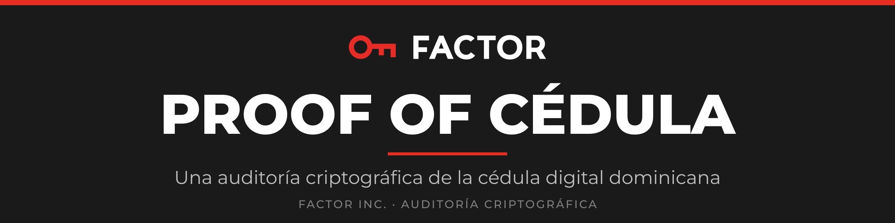
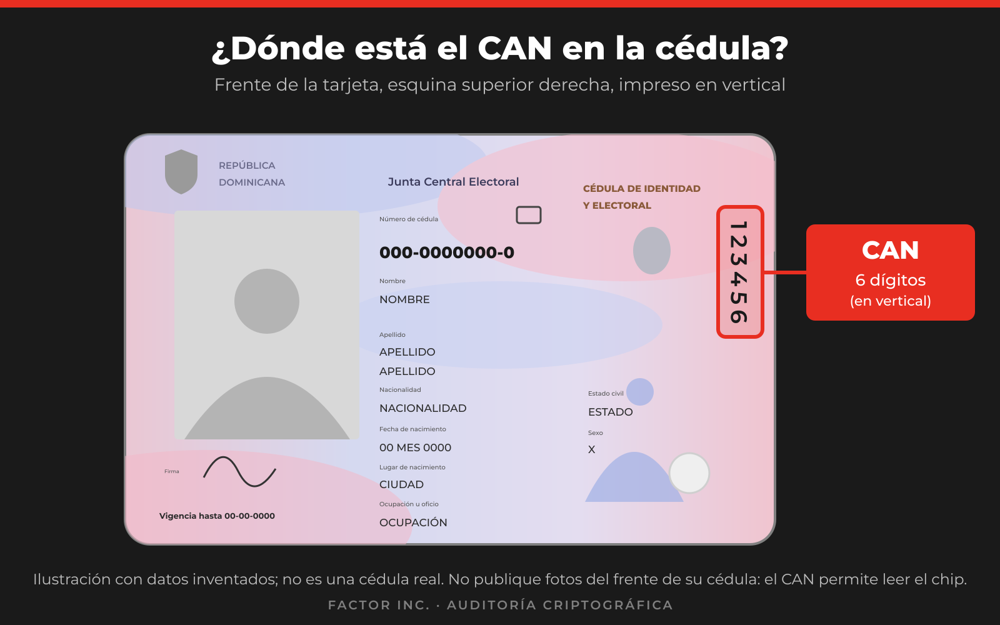
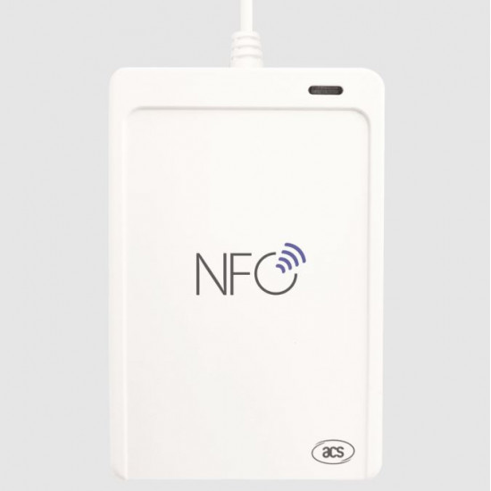
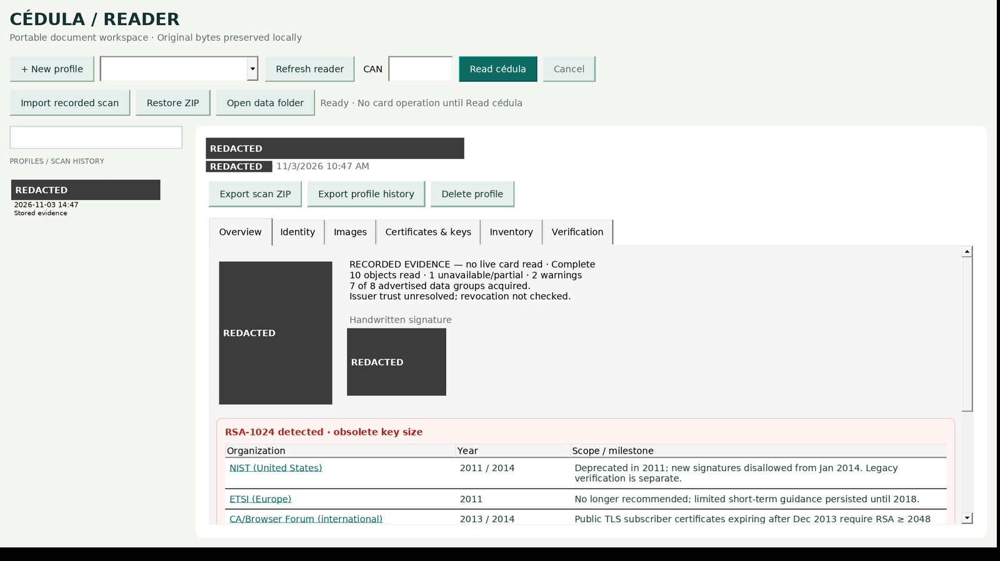
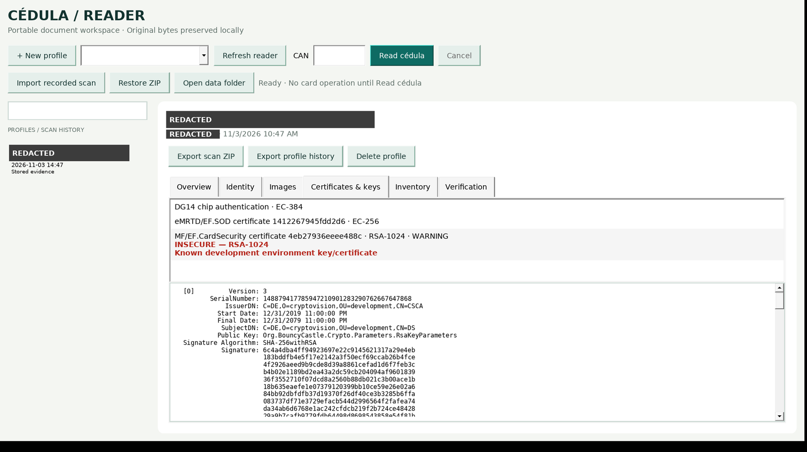

<h1 align="center">
  
</h1>

<p align="center"><b>Findings, evidence, and open-source readers.</b></p>

<p align="center">Research by <b>FACTOR Inc.</b>, the commercial arm of Project FACTOR · <a href="https://projectfactor.io">projectfactor.io</a></p>

<p align="center">
  <a href="report/informe_cedula_EN.pdf"><b>📄 DOWNLOAD THE SECURITY REPORT (PDF, 3 pages)</b></a><br>
  <i>Test key in production. Nonexistent root of trust.</i><br>
  Findings, threat model, and urgent actions, in an offline-readable format.
</p>

Independent security research on the chip of the Dominican Republic's *cédula de identidad y electoral* (contactless, ICAO eMRTD-based). Disclosed to the Junta Central Electoral (JCE) before publication.

> [!NOTE]
> **The Junta Central Electoral (JCE) has already been informed of the most serious findings of this audit** before publication. See the [disclosure timeline](DISCLOSURE_TIMELINE_EN.md).

> [!IMPORTANT]
> ## Our main recommendation: a complete audit, backed by the JCE
>
> This work used **public information only**. We had no access to the JCE's records, key ceremonies, signing hardware, or vendor documentation, so it **cannot rule out other flaws**.
>
> We **strongly** recommend that the JCE:
> - **Commission a complete, independent cryptographic audit**, led by qualified cryptographers and backed by the JCE's authority.
> - **Decide on card reissuance only after the audit presents its results.**
>
> Details: [`FINDINGS_EN.md`](FINDINGS_EN.md#full-audit)

## Contents

- [Summary of findings](#summary-of-findings)
- [Frequently asked questions for citizens](FAQ_EN.md)
- [Scope and ethics](#scope-and-ethics)
- [Reading a cédula](#reading-a-cédula)
- [Repository structure](#repository-structure)
- [Reproducing the results](#reproducing-the-results)
- [About the author](#about-the-author)
- [License](#license)

## Summary of findings

**Color key**

- 🔴 Confirmed defect
- 🟠 Trust gap or uncertainty
- 🟡 Depends on the verifier
- 🟢 *A specific, named test passed on the indicated cards.* (Green never means "secure," "certified," or "trustworthy," and says nothing about untested cards or attacks.)

Signature integrity, trust in the issuer, algorithm strength, and development/production provenance are reported separately and are not mixed together.

| # | Status | Finding |
|---|---|---|
| 1 | 🔴 Defect | `EF.CardSecurity` is signed by an **RSA-1024 Document Signer from a vendor *development* environment** (`cryptovision/development`). Obsolete algorithm plus development provenance. **An assurance gap:** it passed issuance undetected (see Finding 1, Assurance gap). Observed on all production cards examined. |
| 2 | 🟠 Trust gap | The URI of the JCE's CSCA anchor (`https://ca.jce.gob.do/csca`) does not resolve, so a verifier cannot independently anchor the `EF.SOD` signer's chain. The signature itself is valid. |
| 3 | 🟢 Named tests passed (cards tested) | The `EF.SOD` signature is valid and 7 of 7 readable data groups match their signed hashes. Chip Authentication, the MAC tampering and Secure Messaging downgrade tests, writes via CAN/PACE, and the PIN retry counters behaved correctly. This is not a claim that the card or the issuer is secure or trustworthy. |

Each finding is broken down in [`FINDINGS_EN.md`](FINDINGS_EN.md) into a plain-language summary, the regulatory position, the cryptanalytic context, and the attacks it can enable, including those that require other components.

**Scale and reissuance.** About 4.0 million new cédulas have already been delivered, out of 8.7 million enabled ([Diario Libre](https://www.diariolibre.com/politica/jce/2026/10/13/jce-supera-los-cuatro-millones-de-cedulas-entregadas/3688288)). We do not recommend a blanket reissuance before that audit. In the meantime, fix the personalization of cards not yet issued, and then establish whether those already issued can be updated. Reissue only what cannot be fixed. Reasoning and conditions: [`FINDINGS_EN.md`](FINDINGS_EN.md#f1-reissue).

### Cloning and forgery risk

The write protection of the genuine card is not the relevant barrier. An attacker does not need to write to a real card. They can read one, then copy and alter its data onto a blank card or an emulator. Whether it is accepted depends on what the verifier checks:

| Step | The attacker needs | Status |
|---|---|---|
| Copy readable data (DG1, DG2, …) to a blank card or emulator | Only the CAN | Possible. The CAN is printed on the front of the card, so anyone who has it in their hands, even briefly, can read the data. |
| Pass **Passive Authentication** with the *unmodified* copy | Nothing | Passes. The signed hashes still match. |
| Pass **Chip Authentication** (proof that the chip is genuine) | A forged `EF.CardSecurity` with a key chosen by the attacker | 🔴 **Enabled by Finding 1.** Whoever recovers or factors the RSA-1024 development key can sign it. |
| Pass Passive Authentication with *modified* identity data | A forged `EF.SOD` | 🟡 Blocked by the production EC signer, **unless** the verifier also accepts SODs signed by the RSA-1024 development certificate. |
| Get a forged card accepted | A verifier that trusts the RSA-1024 certificate or does not anchor to a pinned CSCA | 🟠 **Finding 2.** The JCE's CSCA is unreachable, so verifiers that obtain it at runtime may accept by default. |

**In short:** any application that trusts the RSA-1024 development certificate, or that accepts a signer it cannot anchor, can be fooled by a cloned or edited card. In what we tested, the risk lies in the verifiers and in the provenance of the signing key, more than in the chip's own protocol checks. Fixing the key and publishing a pinned CSCA must be done together.

## Scope and ethics

- Covers only the cryptographic layer of the chip. It does not include the physical security features, the JCE's infrastructure, or anything beyond what a contactless reader can observe.
- The cards were examined with their holders' permission, using documented ICAO/ISO protocols and tests that do not modify state.
- Excluded: citizen data, photos, private keys, PINs, and CANs. The screenshots below are redacted.
- Timeline: [`DISCLOSURE_TIMELINE_EN.md`](DISCLOSURE_TIMELINE_EN.md).

## Reading a cédula

The readers are read-only. They use the CAN (the six-digit number printed on the card) via PACE. They never use signing PINs, never write to the card, and never extract private keys.

**Where is the CAN?** On the **front** of the cédula, in the **upper right corner**, printed **vertically**.

<p align="center"></p>

> **The output contains the holder's personal data, unencrypted.** Read only cards you have the right to read and keep the output out of shared repositories.

| Platform | File | Notes |
|---|---|---|
| Windows 11 x64 | [`bin/CedulaReader-0.1.0-win-x64.zip`](bin/) | Graphical interface, self-contained, unsigned. |
| Linux x64 | [`bin/cedula-reader-0.1.0-linux-x64.tar.gz`](bin/) | Command line. Requires `pcscd` and `libpcsclite.so.1`. |

Verify the download: `sha256sum -c bin/SHA256SUMS`. You also need a PC/SC-compatible contactless reader.

### Recommended reader



**ACS ACR1552U USB NFC Reader IV (USB Type A)** — [buy on Amazon](https://www.amazon.com/dp/B0CJPXCYWK) · [manufacturer page](https://www.acs.com.hk/en/products/575/acr1552u-usb-nfc-reader-iv/)

- CCID and PC/SC compatible, 13.56 MHz, ISO 14443 Type A/B. It is the reader with which the tools in this repository were developed and tested.
- Works with Windows, Linux (`pcscd`), and macOS.
- Place the card flat on the reader's NFC logo.

<br clear="right">

*Photo: product image taken from a retailer listing, shown for identification purposes only. No affiliation with ACS or Amazon.*

### Windows graphical interface

1. Extract the ZIP into a writable folder and run `CedulaReader.exe`. It requires no installer, .NET, or internet.
2. Connect the reader and click **Refresh reader**.
3. Click **New profile**, place the card on the reader, enter the CAN, and click **Read cédula**. There is no automatic retry.
4. Review the tabs: Overview, Identity, Images, Certificates & keys, Inventory, and Verification.
5. **Export scan ZIP** saves the originals, the extracted images and certificates, the PDF/JSON reports, and the SHA-256 manifests. **Restore ZIP** imports them on another machine.

The application interface is in English only. Button names are kept as they appear on screen.



*Overview. The red banner flags the RSA-1024 key and lists when NIST, ETSI, and the CA/Browser Forum retired it. Identity redacted.*



*Certificates & keys. The `EF.CardSecurity` signer (`C=DE, O=cryptovision, OU=development`) is marked INSECURE, with the full certificate decoded below. Identity redacted.*

The screenshots come from the current version running under Wine (the interface smoke test passes) on a **recorded** scan. The application labels recorded evidence as such. Nothing is read from a card until you click **Read cédula**.

### Linux command line

```sh
mkdir cedula-reader && tar -xzf cedula-reader-0.1.0-linux-x64.tar.gz -C cedula-reader && cd cedula-reader
./cedula-reader readers                                   # lists the PC/SC readers
CEDULA_CAN=<six digits> ./cedula-reader read --data ./Data --export scan.zip
```

The CAN can also be sent via stdin or entered at a hidden prompt. It is never written to disk. Scans use the same `Data/` format and the same ZIP export as the Windows application.

**Validation status.** The PACE and parsing core passes a regression suite of 53 checks and interoperates with an independent OpenPACE oracle. The prebuilt readers have been validated with live reads of real cards. See [`app/TEST_RESULTS_EN.md`](app/TEST_RESULTS_EN.md). Build from source with `app/scripts/build.sh` (.NET 10).

## Repository structure

| Path | Contents |
|---|---|
| [`FINDINGS_EN.md`](FINDINGS_EN.md) | Findings, attack chains, and what is *not* possible |
| [`FAQ_EN.md`](FAQ_EN.md) | Frequently asked questions for citizens |
| [`REPRODUCE_EN.md`](REPRODUCE_EN.md) | Step-by-step reproduction |
| [`report/`](report/) | PDF reports: vulnerability test results, limits map, actions for the JCE |
| [`evidence/`](evidence/) | Technical records supporting each finding |
| [`tools/`](tools/) | Validation kit (`active_adaptive/`) and independent ICAO passive authentication verifier (`icao/`) |
| [`app/`](app/) | Source code of the readers (.NET 10) |
| [`bin/`](bin/) | Prebuilt readers and checksums |
| [`exports/`](exports/) | Public certificates only; no private keys |

## Reproducing the results

Follow [`REPRODUCE_EN.md`](REPRODUCE_EN.md). In brief: `tools/icao/` verifies Passive Authentication offline, and the tiered scripts in `tools/active_adaptive/` repeat the PACE, Secure Messaging, write protection, and PIN counter checks, using only commands that do not modify state.

## About the author

This research was carried out by **FACTOR Inc.**, a U.S. corporation that is the commercial arm of **Project FACTOR** and provides cryptographic audit services for national identity, civil registry, and e-government systems in Latin America (see the declaration of interests below).

The research was led and signed by **Juan Vargas**, chief executive officer (CEO) of FACTOR Inc. — mathematician, software engineer, and cryptographer.

- Former applied mathematics researcher at the **U.S. National Security Agency (NSA)** (2015–2018; graduate of the Mathematics Development Program).
- Computational scientist at BlackHorse Solutions (2019–2021): post-quantum, lattice-based, and homomorphic cryptography; private information retrieval.
- Founder of **FACTOR**, a proof-of-work blockchain. Funded by a US$100,000 grant from the Coinbase Crypto Community Fund (2022). Dogecoin Core contributor.
- B.S. in Mathematics, UNC Charlotte; NSF-funded doctoral program, University of Georgia.
- Invited talks at INTEC, NSA, UGA, and CyberWeek@LAC4.

Contact: [team@projectfactor.io](mailto:team@projectfactor.io) · [projectfactor.io](https://projectfactor.io) · [github.com/ProjectFactor](https://github.com/ProjectFactor)

### Declaration of interests

- This research was carried out independently. It was not commissioned by the JCE, by the card vendor, or by any third party.
- FACTOR Inc. offers professional cryptographic audit services. This is a commercial interest and is declared here.
- The publication, content, and correction of these findings **are not conditioned on any payment or contract**, and none has been or will be requested to withdraw, delay, or modify them.
- The recommendation of a complete audit holds **regardless of who performs it**. It should be awarded through a transparent process and be independent of the card vendor.
- Any errors that are detected will be corrected publicly.

## License

[MIT](LICENSE). It applies to the tools in this repository.

Corrections from the JCE or other authorized parties are welcome. Open an issue. If you find something sensitive that was overlooked in the review, open an issue rather than a pull request.

<!-- factor-footer:start -->
---

<p align="center"><sub>© 2026 FACTOR Inc. · Cryptographic audit · <a href="https://projectfactor.io">projectfactor.io</a></sub></p>
<!-- factor-footer:end -->
